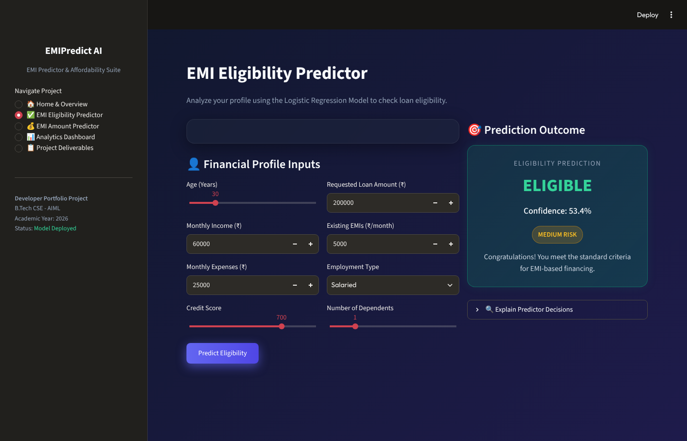
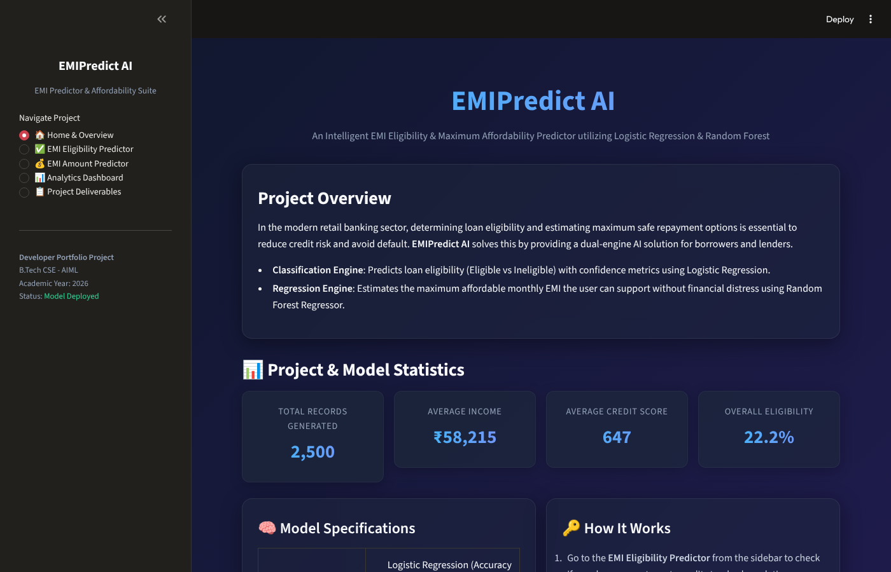
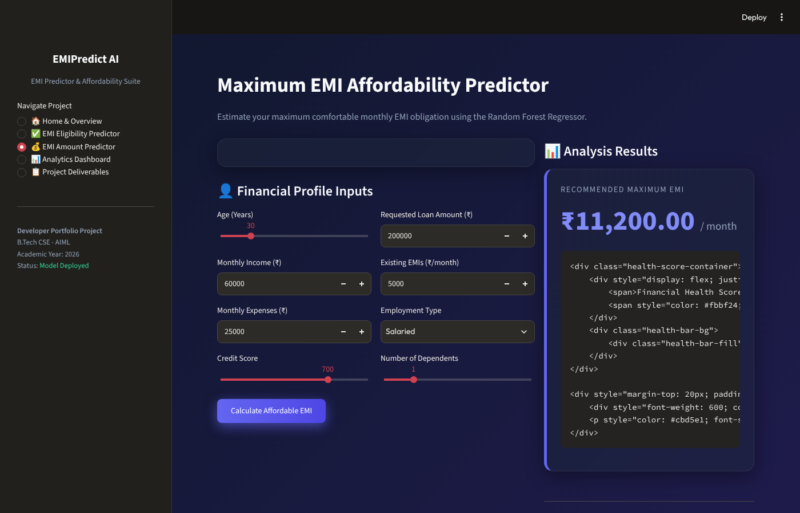
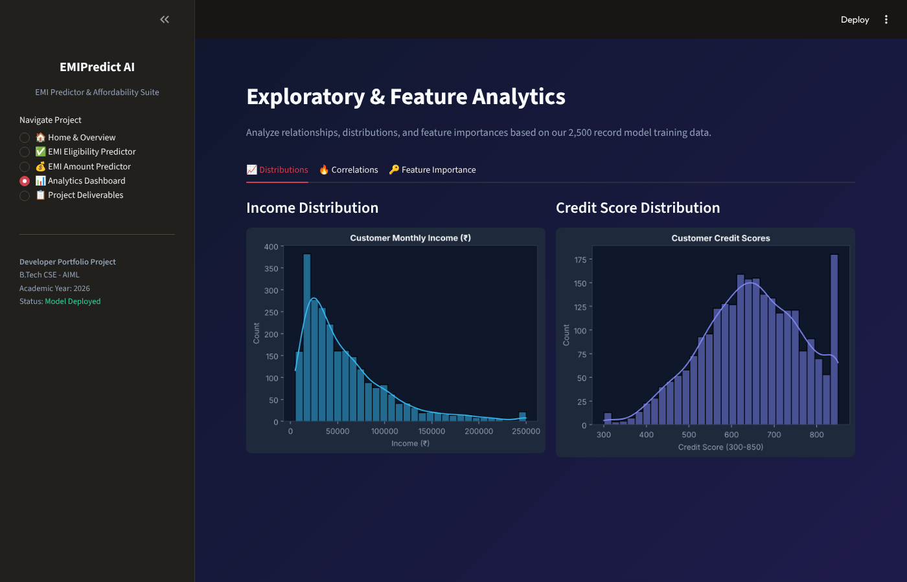

# EMIPredict AI

Predicts whether a loan applicant is eligible for EMI-based financing (**classification**) and the maximum monthly EMI they can afford (**regression**), and serves both models in an interactive Streamlit app.




## Problem

Lenders need two answers for every applicant: *should we lend at all?* and *how large a monthly repayment can this person sustain?* Answering them with fixed rules ignores how income, expenses, credit history and existing debt interact. This project learns both decisions from data and compares a linear baseline with a tree ensemble for each.

## Objectives

- Build one preprocessing pipeline shared by training and inference, so the app can never transform inputs differently from training.
- Benchmark a linear model against a Random Forest for both tasks and pick the winner on the metric that matters for that task.
- Expose the models through an app that a non-technical user can operate.

## Dataset

**Synthetic data: 2,500 applicants**, generated by [`data/generate_data.py`](data/generate_data.py) with a fixed seed, so the results are reproducible.

| Feature | Description |
|---|---|
| `Age` | 21 to 65 |
| `Monthly_Income` | Skewed distribution, ₹15k to ₹250k |
| `Monthly_Expenses` | 25 to 70% of income plus a base amount |
| `Credit_Score` | 300 to 850, centred on 650 |
| `Existing_Loan_Amount`, `Existing_EMI` | Present for about 55% of applicants |
| `Employment_Type` | Salaried / Self-Employed / Unemployed |
| `Dependents` | 0 to 4 |

**Targets.** `EMI_Eligibility` comes from a credit-risk logit based on credit score, debt-to-income ratio, employment, dependents and age, with 4% label noise. About 22% of applicants are eligible, so the classes are imbalanced. `Max_Affordable_EMI` is derived from disposable income for eligible applicants.

> Because the labels come from known rules, these scores show how well each model recovers those rules. They do not predict performance on real lending data.

## Approach

```
emi_dataset.csv
   │  80/20 train/test split (stratified on eligibility, random_state=42)
   ▼
ColumnTransformer
   ├── StandardScaler   → 7 numeric features
   └── OneHotEncoder    → Employment_Type (drop first)
   │
   ├──► Classification:  LogisticRegression  vs  RandomForestClassifier(max_depth=10)
   └──► Regression:      LinearRegression    vs  RandomForestRegressor(max_depth=12)
   │
   ▼
Best pipelines → models/*.joblib  →  Streamlit app (app.py)
```

## Results

Reproducible with `python models/train.py` (the notebook gives identical numbers). Test set: 500 applicants.

**Eligibility (classification)**

| Model | Accuracy | Precision | Recall | F1 |
|---|---|---|---|---|
| **Logistic Regression** ✔ | **89.8%** | 86.6% | **64.0%** | **73.6%** |
| Random Forest | 88.4% | 90.8% | 53.2% | 67.1% |

Logistic Regression was selected on F1. With only 22% positives, accuracy alone would reward a model that rarely predicts *eligible*. The Random Forest is more precise but misses almost half the eligible applicants.

**Maximum affordable EMI (regression)**

| Model | RMSE | MAE | R² |
|---|---|---|---|
| Linear Regression | ₹8,757 | ₹6,162 | 0.714 |
| **Random Forest** ✔ | **₹6,969** | **₹3,577** | **0.819** |

The Random Forest captures the non-linear effect of disposable income on affordability that a linear model cannot.

**Most important features** (Random Forest importance): credit score (0.37) and monthly income (0.19) drive eligibility. Monthly income (0.51) and credit score (0.25) drive affordable EMI.

## App

| | |
|---|---|
|  |  |
|  |  |

- **Eligibility Predictor:** eligibility with model confidence and a risk band.
- **EMI Amount Predictor:** maximum affordable EMI, plus a calculator that converts it into a maximum loan principal for a chosen interest rate and tenure.
- **Analytics:** feature distributions, correlation heatmap and feature importances.

## Project structure

```
├── app.py                    # Streamlit entry point (run from repo root)
├── app/main.py, app/utils.py # Same app, runnable from app/
├── data/
│   ├── generate_data.py      # Synthetic data generator (seeded)
│   └── emi_dataset.csv
├── models/
│   ├── train.py              # Trains, evaluates and saves the best pipelines
│   └── *.joblib              # Saved pipelines, metrics and feature importances
├── notebooks/
│   └── emi_prediction_model.ipynb   # EDA and model comparison, with outputs
├── reports/                  # Project report and presentation notes
└── docs/screenshots/
```

## Run it

```bash
git clone https://github.com/sahithi-manda/EMIPredict-AI.git
cd EMIPredict-AI
python -m venv venv && source venv/bin/activate   # Windows: venv\Scripts\activate
pip install -r requirements.txt

python data/generate_data.py   # optional: regenerate the dataset
python models/train.py         # optional: retrain and print metrics
streamlit run app.py
```

## Limitations and next steps

- **Train on real data.** The obvious next step is a public credit dataset, where noise and missing values are realistic.
- Tune the classification threshold, or use class weights, to trade precision for recall depending on the lender's risk appetite.
- Try gradient boosting (XGBoost or LightGBM) and use cross-validation instead of a single split.
- Add experiment tracking (e.g., MLflow) to log runs and parameters.
